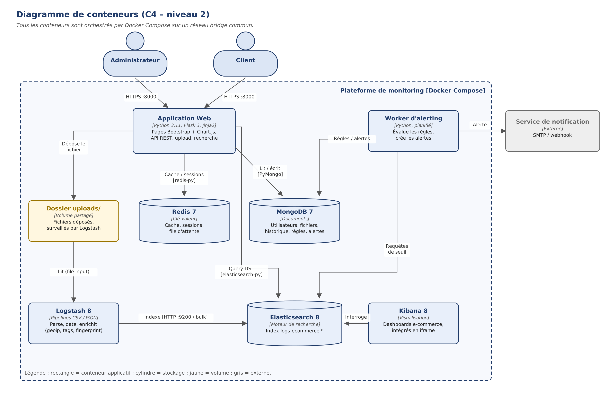

# E-Commerce Log Monitoring and Analytics Platform

Plateforme de collecte, d'indexation, de recherche et de visualisation des logs d'un site e-commerce
(mini-projet Big Data — Scénario A).

**Stack :** Elasticsearch 8 · Logstash 8 · Kibana 8 · MongoDB 7 · Redis 7 · Flask 3 · Docker Compose

> État : **semaine 1 — analyse et conception.** L'application affiche une page « Hello World » ;
> les fonctionnalités sont développées sprint par sprint (voir le backlog Jira).

## Architecture



| Service | Rôle | Port |
|---|---|---|
| `webapp` | Application Flask (pages web + API REST) | 8000 |
| `alert-worker` | Évaluation périodique des règles d'alerte | — |
| `elasticsearch` | Indexation et recherche des logs | 9200 |
| `logstash` | Ingestion des fichiers CSV / JSON | 9600 |
| `kibana` | Dashboards | 5601 |
| `mongodb` | Utilisateurs, fichiers, historique, alertes | 27017 |
| `redis` | Cache, sessions, file d'attente | 6379 |

Documentation de conception : [`docs/`](docs/) (cas d'utilisation, C4, déploiement, séquences,
[modèle de données](docs/modele-donnees.md), maquettes).

## Prérequis

- Docker 24+ et Docker Compose 2+
- 4 Go de RAM disponibles pour Docker (Elasticsearch en utilise 1 Go)

## Démarrage

```bash
git clone https://github.com/<votre-compte>/elk-ecommerce-monitoring.git
cd elk-ecommerce-monitoring
cp .env.example .env          # puis adapter les mots de passe
docker compose up -d --build
```

Le premier démarrage télécharge les images (environ 3 Go) : compter 5 à 10 minutes.

## Vérifier que tout fonctionne

```bash
docker compose ps                       # tous les services « running » / « healthy »
curl http://localhost:9200              # Elasticsearch répond
curl http://localhost:8000/health       # {"status": "healthy"}
```

- Application : http://localhost:8000
- Kibana : http://localhost:5601

## Générer et ingérer des logs e-commerce

Le générateur (`scripts/generate_logs.py`, Faker) produit des événements réalistes : navigation,
paniers, paiements, commandes, erreurs applicatives, lenteurs, sécurité, avec quelques pics
d'erreurs de paiement pour tester les alertes.

```bash
docker compose run --rm generator --count 20000 --days 30 --out uploads
```

Les fichiers CSV et JSON sont écrits dans `uploads/`. Logstash les détecte en quelques secondes
(un pipeline par format, voir `logstash/config/pipelines.yml`) et les indexe dans
`logs-ecommerce-AAAA.MM` :

```bash
curl "http://localhost:9200/_cat/indices/logs-ecommerce-*?v"
curl "http://localhost:9200/logs-ecommerce-*/_count"
```

Traitements Logstash : parsing CSV / JSON, date (`@timestamp`), géolocalisation de l'IP,
tags par catégorie, tag `suspicious` (score de fraude > 0,7), identifiant SHA-256 pour éviter
les doublons en cas de réimport. Des fichiers d'exemple sont fournis dans `data/sample/`.

> Sécurité Elasticsearch désactivée volontairement (environnement de développement local).
> Projet testé avec Docker 20.10 et Docker Compose 2.12.

## Application et API REST

- Connexion : http://localhost:8000/login. Un administrateur est créé au premier démarrage avec
  `ADMIN_EMAIL` / `ADMIN_PASSWORD` du fichier `.env` (par défaut `admin@ecommerce.tn` / `Admin@2026`,
  à changer).
- **Documentation interactive (Swagger UI)** : http://localhost:8000/api/docs. Spécification OpenAPI :
  http://localhost:8000/api/openapi.json (copie dans `docs/openapi.json`).

| Méthode | Route | Rôle | Description |
|---|---|---|---|
| POST | `/api/v1/auth/login`, `/logout` · GET `/me` | tous | Session stockée dans Redis |
| GET | `/api/v1/logs` | tous | Recherche plein texte + filtres (niveau, service, catégorie, dates), 50 par page, cache Redis 60 s |
| GET | `/api/v1/logs/{id}`, `/api/v1/logs/export` | tous | Détail d'un log, export CSV |
| GET / POST | `/api/v1/files`, GET `/api/v1/files/{id}` | admin | Import CSV / JSON / TXT, validation, aperçu, statut d'indexation |
| GET | `/api/v1/stats/summary`, `/timeline`, `/breakdown` | tous | KPI, évolution, répartition, Top 10 des erreurs |
| GET / POST / PATCH | `/api/v1/users` | admin | Comptes clients et catégories autorisées |
| GET | `/api/v1/search-history` | tous | Mes dernières recherches (MongoDB) |

Un client ne voit que les catégories de logs autorisées pour son compte.

Format TXT accepté (une ligne par log) : `2026-11-19T10:42:13Z ERROR [payment] Payment gateway timeout`.

### Tests

```bash
docker compose exec webapp sh -c "pip install -q -r requirements-dev.txt && python -m pytest -q"
```

Les tests utilisent des doubles de MongoDB (mongomock), Redis (fakeredis) et Elasticsearch : ils ne
modifient pas les données réelles.

## Arrêter

```bash
docker compose down        # arrête les conteneurs
docker compose down -v     # arrête et supprime aussi les données (volumes)
```

## Structure du dépôt

```
.
├── docker-compose.yml
├── .env.example
├── webapp/                 # Application Flask + worker d'alerting
│   ├── Dockerfile
│   ├── requirements.txt
│   ├── worker.py
│   └── app/  (templates/, static/)
├── logstash/pipeline/      # Pipelines Logstash (test, puis CSV et JSON)
├── elasticsearch/          # Index template logs-ecommerce-*
├── kibana/                 # Exports des dashboards (NDJSON)
├── scripts/                # Générateur de logs e-commerce (Faker)
├── data/sample/            # Petits fichiers d'exemple
├── uploads/                # Dossier partagé webapp ↔ Logstash (non versionné)
├── tests/
└── docs/                   # Diagrammes, maquettes, modèle de données
```

## Gestion de projet

Backlog et sprints : Jira (projet SCRUM, 7 sprints d'une semaine).
